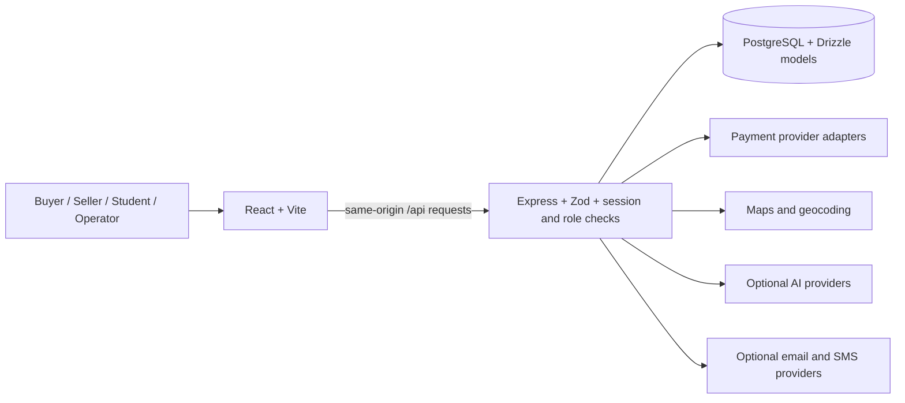

# AgriConnect

**A full-stack agricultural marketplace that brings product discovery, farmer-to-buyer commerce, logistics, and community services into one connected platform.**

Built with **React, TypeScript, Express, and PostgreSQL**, AgriConnect explores how a marketplace can support the people around agriculture, from individual buyers and sellers to students, regional organisations, and platform operators.

[Live application](https://agri-connect-flame.vercel.app) · [Explore the source](https://github.com/harshgavandit/Agri-Connect) · [Project origins](https://github.com/c-PRESENTS/Agri-Connect)

[](https://github.com/harshgavandit/Agri-Connect/actions/workflows/ci.yml)

## Why this project exists

Selling farm products involves more than publishing a listing. Producers need discoverability, buyers need useful product and seller information, orders need fulfilment, and the platform needs accountable moderation and operations. Those tasks often live in disconnected tools.

AgriConnect brings them into a shared workflow: discover a product or nearby seller, compare options, manage a cart, place an order, and coordinate the next steps. The broader platform also includes land discovery, community sharing, agricultural support, and student resources.

The intended impact is easier market access for producers, more informed purchasing, and less administrative friction. **This repository does not establish measured increases in farmer income, reductions in food waste, transaction volume, or commercial adoption.** Those outcomes require a real pilot and a defined measurement process.

## What you can explore

| Area | Implemented experience | Relevant code |
| --- | --- | --- |
| Marketplace | Hierarchical categories, product discovery, search, comparison, saved products, seller profiles, and location-aware browsing | `frontend/src/pages`, `backend/modules/catalog`, `backend/modules/search` |
| Commerce | Guest and authenticated carts, checkout, orders, saved addresses, and seller workflows | `backend/modules/cart`, `backend/modules/commerce`, `backend/repositories/commerce-repository.ts` |
| Payments | Quote and reservation flows, provider adapters, webhook handling, refunds, disputes, and settlement records | `backend/payments`, `backend/modules/payments` |
| Logistics and maps | Shipping estimates, tracking views, logistics collaboration, nearby discovery, and regional marketplaces | `backend/shipping`, `backend/modules/logistics-collaboration`, `backend/regional-marketplace` |
| Community | Share & Care listings, farmer support, land discovery, and student access workflows | `backend/modules/community`, `backend/modules/student`, `frontend/src/pages` |
| Organisation operations | Role-based administration, product moderation, category management, user verification, analytics, exports, and audit records | `backend/organisations`, `backend/modules/admin` |
| Accessible interactions | Responsive navigation, accessibility controls, language resources, and AI-assisted search, translation, and voice interpretation | `frontend/src/components`, `frontend/src/i18n`, `backend/ai` |

Some features depend on external services or authenticated roles. The presence of an adapter or screen does not mean that its provider has been configured or verified in the public deployment.

## Engineering highlights

- **A modular monolith:** a single application with separate frontend, API, shared contract, persistence, and integration boundaries. This keeps deployment understandable while allowing individual domains to evolve.
- **Shared TypeScript and Zod contracts:** validation and models connect API input, database entities, and frontend workflows.
- **Persistent commerce and sessions:** PostgreSQL stores core commerce and authentication records; Express sessions use a PostgreSQL session store.
- **Multi-role workflows:** buyer, seller, student, organisation, and operator experiences have distinct entry points and access rules.
- **Payment lifecycle modelling:** checkout, idempotency, signed provider webhooks, refunds, disputes, and protected allocations are represented explicitly instead of being reduced to a payment button.
- **Operational interfaces:** moderation queues, permissions, audit records, notifications, and exports address the work required to run a marketplace.
- **Deployment separation:** Vercel serves the built React assets and forwards `/api/*` to an Express function, while the persistent Node server remains available for conventional hosting.

These are useful discussion points for full-stack, backend, frontend, and product engineering interviews. They demonstrate the tradeoffs involved in a multi-sided product; they are not a claim that every subsystem is production-hardened.

## Architecture



React uses Wouter for routing, TanStack Query for server state, Tailwind CSS and Radix primitives for interfaces, Leaflet for maps, and i18next for language resources. The API is organised by domain under `backend/modules/`; shared models live in `shared/`. SQL migrations preserve the evolution of the database.

## Run locally

Use Node.js **22.12+ in the Node.js 22 release line** and PostgreSQL. The project pins Node.js 22 for reproducible hosting.

```bash
npm ci
cp .env.example .env
```

On PowerShell, use `Copy-Item .env.example .env` only when a local `.env` does not already exist. Preserve existing configuration.

Set `DATABASE_URL` and a strong `SESSION_SECRET` privately. The included Docker Compose configuration can provide a **local development** PostgreSQL instance:

```bash
docker compose up -d postgres
```

The example credentials in that Compose file are for local development. Do not expose that database publicly.

For a new, empty database, initialise the schema and reference data before launching. The setup command journals the historical SQL migrations through `0040`, refuses an unrelated existing database, and can resume its own interrupted setup. Read the migration notes below before using an existing database.

```bash
npm run db:setup:fresh
npm run dev
```

Open `http://localhost:5000`. `GET /api/health` is a process health endpoint; it does not prove database or provider readiness.

For a persistent production server:

```bash
npm run build
npm start
```

`npm start` reads the local `.env`; a hosting environment should inject its own variables and can run `node dist/index.cjs` directly.

### Database notes

- Never run schema synchronisation or historical data migrations against a shared database without reviewing the generated changes and taking a backup.
- Historical migrations include reference data, cleanup operations, and environment-specific catalogue ownership transitions. In particular, `0041` and `0042` expect an existing account; they are not generic fresh-database setup scripts.
- A new database does not contain your local users, orders, or sessions. Set `CATALOG_SEED_ENABLED=false` to start with an empty catalogue. The optional legacy catalogue seeder requires an existing, eligible owner selected with `MVP_CATALOG_OWNER_EMAIL`; it must not invent verified sellers.
- Some domain records and demonstration data still use in-process storage. Those records do not have the durability guarantees of the persisted commerce tables.

## Configuration

Start with [`.env.example`](.env.example). The preserved [environment guide](AgriConnect-Agents_Guide/ENV_GUIDE.md) contains broader integration context; actual source code is the authority for current variable names.

| Purpose | Configuration |
| --- | --- |
| Required API runtime | `DATABASE_URL`, `SESSION_SECRET`, `NODE_ENV=production` in production |
| Canonical URLs and callbacks | `PUBLIC_APP_URL`, `APP_ORIGINS`, `PAYMENT_RETURN_BASE_URL` |
| Encrypted security data | `APP_ENCRYPTION_KEY` and the seller verification/document encryption keys |
| Empty fresh catalogue | `CATALOG_SEED_ENABLED=false` |
| Safe demonstration payments | `PAYMENTS_MODE=mock`, leave `PAYMENTS_ENABLED_PROVIDERS` empty |
| Optional identity and bot protection | Google client configuration and Cloudflare Turnstile keys |
| Optional AI | `GEMINI_API_KEY` or `AI_INTEGRATIONS_OPENAI_API_KEY`; provider/model availability must be checked separately |
| Optional student and notification services | Student portal settings, email, and SMS provider configuration |

Never commit `.env`, credentials, private documents, database exports, session data, or test recordings. Browser-exposed `VITE_*` variables are public by design and must never contain server secrets. Use separate keys for development and deployment.

## Deploy to Vercel

The tracked `vercel.json` configures a production build, `dist/public` static output, an API function in `api/index.ts`, and client-side route fallback.

1. Import this repository in Vercel and select the branch to deploy.
2. Use the tracked build settings: `npm run build`; static output is `dist/public`. Initialise a new database separately with `npm run db:setup:fresh`, or restore an existing installation privately before switching its connection. Fresh setup uses `DATABASE_URL_UNPOOLED` when available.
3. Configure a separate hosted PostgreSQL database reachable from Vercel. A `localhost` database URL cannot work from a hosted function.
4. Initialise the deployment database and add required environment variables privately in Vercel.
5. Keep payments in mock mode until provider configuration and the complete sandbox flow have been verified.
6. Deploy, then verify the homepage, a direct nested route, API responses, and session behaviour. `GET /api/ready` checks database connectivity and required schema tables.

**Hosting boundaries:** Vercel functions do not run the application's periodic monitors reliably. This release disables those in-process timers on Vercel; scheduled reconciliation, provider review, maintenance, and opportunity scanning need a separate persistent worker or authenticated scheduled jobs. Seller document uploads currently use filesystem storage and need durable object storage before real verification documents are accepted. Process-local rate limits do not provide a global distributed limit across function instances.

The data-centre backup screens include prototype behaviour; they do not establish that a recoverable external backup exists. Do not use this deployment for real financial operations, sensitive verification documents, or disaster recovery without completing those integrations and validating their controls.

### Public deployment configuration

The public instance uses a separate hosted database. Deploying source code or copying environment variables does not copy local database records: an existing installation needs a private database migration that preserves ownership, permissions, and encryption compatibility. Production builds do not run data migrations automatically. Google sign-in, Stripe test keys, Razorpay test keys, Vonage SMS, and Turnstile configuration are supplied privately through Vercel. Domain allowlists and provider callback configuration must be completed in the corresponding provider consoles before those external flows can be verified. Blank AI provider keys are not a configured AI service.

Payment execution remains in `PAYMENTS_MODE=mock`. The internal mock adapter intentionally rejects checkout in production, so stored test gateway credentials do not activate payment processing. A later, explicitly authorised sandbox activation is required to exercise Stripe or Razorpay on the hosted site. Student test access and E2E bypass routes remain disabled.

## Verification

The project includes Playwright coverage for marketplace workflows, payment APIs, organisation access, moderation, categories, employee security, conversations, student support, and regional marketplaces.

```bash
npm run check
npm run build
npm run qa:links
```

Focused browser suites require a running application and an isolated, prepared database:

```bash
npm run qa:foundation
npm run qa:marketplace
npm run qa:payments
npm run qa:organisation
npm run qa:student
```

Some package scripts reference readiness tests that are absent from the current checkout. Inspect the target file before using a script. Do not run broad or mutating E2E suites against a public deployment or a database containing real user data.

Build success, browser rendering, a health response, and a real provider transaction are different levels of evidence. Treat each claim according to what was actually exercised.

## Project structure

```text
api/                    Vercel request entry point
backend/
  auth/                 Sessions, identity, and account security
  modules/              Domain API route registration
  organisations/        Administration and permission services
  payments/             Payment lifecycle and provider integration
  repositories/         Persistence operations
  runtime/              Local Vite and production static serving
frontend/
  src/app/              Routes and application shell
  src/components/       Product and operational interfaces
  src/pages/            Page-level workflows
  src/i18n/             Language resources
shared/                 Shared models, validators, and contracts
database/migrations/    Historical SQL schema and data migrations
scripts/                Build, setup, and maintenance utilities
tests/e2e/              Focused Playwright suites
```

## Contributing and provenance

This portfolio release builds on the existing [c-PRESENTS/Agri-Connect](https://github.com/c-PRESENTS/Agri-Connect) project and the local implementation. Preserve attribution to earlier contributors; the upstream history provides the original development context. The personal repository starts from a reviewed source snapshot so legacy committed local configuration is not republished.

For changes, trace the affected frontend, API, shared contract, and persistence path together. Keep credentials and real records out of examples and test fixtures. Report issues with reproduction steps and a clear distinction between expected behaviour and verified results. Follow the preserved repository agent guide when using coding assistants.

The package metadata declares MIT. The inherited checkout has no root `LICENSE` file; confirm the upstream licensing and asset permissions before redistributing it under a new licence. Individual asset provenance files remain with their assets.
